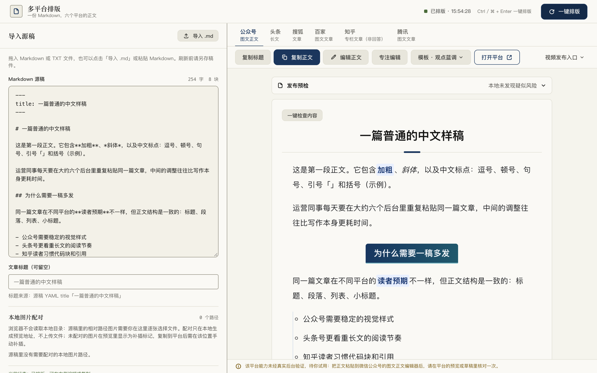
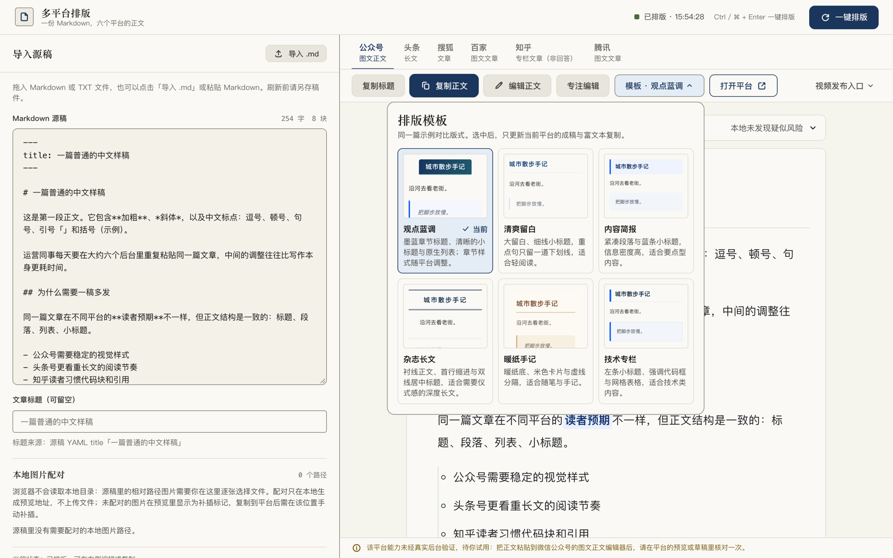

<div align="center">

# 多平台 Markdown 排版

**一份 Markdown 源稿 → 六个平台可直接粘贴的标题与正文**

面向中文内容运营的桌面排版工作台：微信公众号、头条号、搜狐号、百家号、知乎、腾讯内容开放平台。


[快速开始](#快速开始) · [功能一览](#功能一览) · [排版模板](#六平台排版模板) · [已知边界](#已知边界)

</div>



## 这个工具解决什么

运营同事每天要在大约六个后台里重复粘贴同一篇文章，中间的调整往往比写作本身更耗时间。同一篇文章在不同平台的读者预期不一样，但正文结构是一致的。

工具把「排版」和「复制」做完，剩下的事情留给平台后台：

- **只做排版与复制。** 不代登录、不上传稿件、不自动发布。
- **日常排版与草稿留在浏览器。** 在本地解析、渲染、复制；只有启用并主动点击 DeepSeek AI 检查，才向 DeepSeek 发送当前成稿的标题和正文纯文本。无工作台后端。
- **说清兼容代价。** 每个平台降级了什么、丢了什么、需要手动补什么，都写在界面上，而不是让人粘贴完才发现。

## 功能一览

| 能力 | 说明 |
| --- | --- |
| 一键排版 | 一次源稿 → 六份标题 + 内联样式正文，单平台失败不影响其他平台 |
| 六套排版模板 | 观点蓝调、清爽留白、内容简报、杂志长文、暖纸手记、技术专栏，各平台独立记忆 |
| 直接改稿 | 在右侧分别编辑各平台的标题与正文；左侧 Markdown 保持原样 |
| 草稿自动保存 | 同一浏览器、同一网址重新打开时恢复最近一篇，包括各平台改动、模板和本地图片 |
| 图片处理 | 拖入正文插入本地图片（PNG/JPG/WebP/GIF/AVIF，单张 ≤ 5 MB），插图只保留在当前平台成稿 |
| AI 内容检查 | 只连接 DeepSeek，检查当前平台成稿并提供定位；排版基线差异另用本地比对 |
| 兼容性清单 | 按平台能力声明生成降级提示，表格被降级、外链被移除都能定位来源 |
| 发布预检 | 六平台规则库 + 风险片段提示，复制前确认，旧稿不会被当作已检查 |
| 富文本复制 | HTML 与纯文本双格式，浏览器 API 被拦截时提供手动兜底 |
| 发布入口 | 视频号、小红书、抖音创作页，以及当前平台的创作中心，新标签页打开 |

成稿操作栏右侧的「视频发布入口」默认收起，展开可打开 [微信视频号](https://channels.weixin.qq.com/platform/post/create)、[小红书](https://creator.xiaohongshu.com/publish/publish) 和 [抖音](https://creator.douyin.com/creator-micro/content/upload) 的发布页，未排版也能使用。「打开平台」进入当前文章平台，选中搜狐号时按钮显示「打开创作中心」。外链在新标签页打开，稿件留在工具里。登录后可在平台手动上传素材、填写内容并发布。

## 快速开始

需要 Node.js `^20.19.0 || >=22.12.0`（Vite 7 的要求）。

```bash
npm install        # 或 pnpm install
npm run dev        # 本地开发，默认 http://localhost:5173
npm run build      # 类型检查 + 生产构建到 dist/
npm run preview    # 预览构建产物，http://localhost:4173
```

质量命令：

```bash
npm run typecheck  # tsc --noEmit，strict
npm run lint       # eslint（typescript-eslint 类型感知规则）
npm run test       # vitest run
```

打开页面后，把仓库里的 [普通样稿](tests/fixtures/plain.md) 或 [复杂样稿](tests/fixtures/complex.md) 拖到左侧，点「一键排版」即可看到六个平台的成稿。

### 公网访问与更新

- `npm run dev` 读取源码；`npm run preview`（通常是 `4173`）读取上一次构建的 `dist/`，不会随源码改动更新。公网发布时每次先运行 `npm run build`，再用新的 `dist/` 整目录替换托管内容，不要把 Vite 开发或预览端口直接当作公网服务。
- 对外请使用有可信证书的 **HTTPS** 静态托管或反向代理，现有 HTTP 入口可在托管端重定向到 HTTPS。普通 HTTP 地址默认不能输入 API Key。唯一例外是直接打开本机工作台的指定局域网地址 `http://192.168.0.101:4173/`：在「AI 设置」点击「了解风险，临时允许输入」，密钥仅保留在当前页面，刷新或关闭后须重新输入，不写入浏览器存储。HTTP 页面本身不加密，可能被篡改并窃取密钥，只在信任的网络临时使用。此例外不适用于其他 IP、端口或 iframe；长期或对外使用请配置可信的 HTTPS。
- 换域名、端口或由 HTTP 切换 HTTPS 时，浏览器会把新旧网址的数据分开。切换前先备份旧网址中的草稿，再在新网址重新导入和配置 AI；不要清除旧地址的站点数据来刷新版本。

## 导入源稿，排版后修改成稿

把一份 UTF-8 Markdown 或 TXT 稿件拖到左侧，也可以点「导入 .md」选择文件，或粘贴 Markdown 文本。文件导入后只读；粘贴的 Markdown 首次成功排版后也会锁定。重新导入有效的新文件时，确认后才会清除旧原稿和右侧六份成稿；取消或导入失败会保留原有内容。原稿里已有的本地图片路径仍可在左侧配对。

点「一键排版」，在右侧选中平台，再点复制按钮旁的「编辑正文」或「专注编辑」。可在「当前平台标题」中改标题，也可直接改正文或使用上方工具栏调整小标题、加粗、高亮、列表等格式。把单张本地图片拖到正文要插入的位置，也可以在光标处粘贴图片（`⌘/Ctrl + V`）或点「插入图片」选择文件。支持 PNG、JPG、WebP、GIF、AVIF，单张不超过 5 MB。点「完成编辑」退出编辑模式，「复制正文」使用修改后的版本。

- 不能把图片拖入代码文字内，请选择普通正文段落。
- 「一键排版」后的六个平台成稿默认优先使用微软雅黑，不改模板原有字号或代码的等宽字体。正文编辑时，工具栏显示光标或选区对应的字体和字号；选区内的值不一致时，显示「字体」或「字号」。
- 选中正文文字后，可选微软雅黑、黑体、宋体、楷体，以及 12–72 px 的任意整数字号。样式随「复制正文」的富文本带出，不写入 Markdown；设备没有所选字体时会回退到相近字体。
- 默认在右侧改标题、正文、格式或插图只影响当前平台，不会写回左侧。「撤销右侧改动」恢复当前平台的标题和正文；如果是在联动来源上撤销，恢复后的内容也会同步给仍在跟随的平台。
- 要让其他平台一起更新，在来源平台的成稿操作栏点「实时联动」，勾选目标，再点「开始联动」。确认会替换这些目标的标题和正文（包括已有改动）；未选平台不变。切换标签不会更改联动来源。取消勾选或停止联动后，目标保留最后一次同步的内容；在目标上手动改稿会自动取消该平台的跟随。刷新或重新排版不会继续联动，已同步草稿仍会保留。
- 联动和一键排版使用同一套平台适配；目标保留自己的模板和字体字号设置，而不是照搬来源样式。尽量保留未改段落原有的表格、外链和图片语义；若直接编辑了来源中已降级、无法安全还原的结构，目标正文会保留上一版并提示原因。可撤销那处编辑，或从保留完整结构的平台发起联动。联动只更新工具内的草稿，不会更新网站里的草稿或自动发布。
- 同一原稿重新排版时保留已编辑的标题和正文。如果调整了原稿图片配对，新的配对会应用到重新生成的未编辑正文；手动编辑过的版本不覆盖，可在右侧单独换图。
- 在分隔线上拖动可调整栏宽；用 `Tab` 聚焦后，左右方向键微调，双击或 `Enter` 恢复默认。点「专注编辑」后，可以用格式工具下方的「画布大小」调整正文框的宽度、高度和显示比例；滑块也支持方向键，并可一键恢复默认。设置记在本浏览器，不改变稿件或复制出的排版。按 `Esc` 或点「退出专注」恢复双栏，正文继续保持编辑状态。
- 上方显示「草稿已保存到本机」后，可以放心刷新或关闭；使用同一浏览器和同一网址回来会自动恢复。若提示未保存，请先复制备份。草稿不跨设备同步，清除该站点数据会删除草稿。导入的原文件不会被改写。复制后仍请在实际平台预览检查图片；如果内嵌图片被过滤，请在平台补插。

## 内容检查与兼容定位

1. 通过 **HTTPS 或本机 `localhost`** 打开工作台，点顶栏「AI 设置」。地址固定为 DeepSeek 官方接口，默认 DeepSeek Flash，可选 V4 Pro。填写从 [DeepSeek 开放平台](https://platform.deepseek.com/api_keys) 创建的 API Key，测试连接成功并同意发送范围后启用。弹窗的「DeepSeek API 充值」会在新标签页打开 [官方充值页](https://platform.deepseek.com/top_up)，登录和支付都在 DeepSeek 完成，工作台不会代扣款。连接测试只发送固定样例，可能产生少量 API 用量。默认只在当前页面保留；在自己的设备上勾选「在此浏览器记住配置」再启用，同一浏览器以同一站点地址重开后会恢复 API Key 和模型，不会自动测试或发送稿件。Key 不加密，保存在该站点的浏览器数据中，不写入草稿、不跨设备同步；共用设备请勿勾选。可点「清除配置」，或取消勾选后保存以改为仅当前页面使用。普通 HTTP 不允许配置 AI，只有上文的指定局域网地址可经确认在当前页面临时使用。
2. 排版后点右侧「AI 检查内容」，只向 DeepSeek 发送当前平台的标题和正文纯文本，不发送图片文件、附件、链接目标或原始 Markdown。结果在独立面板列出原句、问题和修改建议；普通编辑时在左侧，专注编辑时在右侧，窄屏在上方。点「定位」可跳到原文。关闭后再次点「AI 检查内容」可查看现有结果，不会重复发送稿件；要重新发送当前成稿请点面板内的「重新检查」。成稿上方的「AI 定位」保留当前序号和原句摘录，可用「回到此处」重新查看，或点「上一处」「下一处」依次核对。同一段有重复原句时只定位整段，不能核对的建议不展示。修改同一成稿时保留本次建议和当前序号，不会自动复检。原句还在就继续精确定位；原句改过则可回到对应标题或段落核对；删段或无法确认位置时保留原建议并说明无法定位。定位状态不代表 AI 已确认修复。切换平台、换原稿、重新排版、换模板或撤销整版改动时，不沿用上一次的检查结果。
3. 「本地比对」独立可用，不需要 AI，仍提示疑似缺段、文字缩水或图片、外链、表格、代码块减少。已删除的段落显示基线序号和摘录，不会跳到别的段落。

有兼容性问题时，点当前平台的「兼容性」可打开同样的详情面板；不打开也会显示风险摘要，并在复制前要求确认。兼容性清单随当前成稿实时重算；只能从源稿核对的事项会标注「重新排版确认」。表格降级等问题会在对应的正文块标红。外链被移除时，清单的「定位」会在左侧选中对应的 Markdown 原文。无法可靠定位时可以按清单提供的原文片段查找。红色标记只在工作台里显示，复制成稿仍使用原有格式。

## 六平台发布预检

选择右侧任一平台，预览上方的「发布预检」默认只显示摘要，发现风险或重新检测都不会自动打开详情。点击「发布预检」可在独立面板查看风险与「该平台发布规则与来源」，展开时不改变正文布局；未排版也能查阅官方链接、条款摘要和人工核对项。规则和查阅日期集中维护在[平台规则库](src/core/publish-review/policies.ts)，更新时请核对官方原文，而不是只改检查词。

一键排版后，工具按平台在本机检查实际成稿的标题和文字；发现疑似风险时显示标题或正文文字块位置、摘录和处理建议。每条提示的「定位」会先收起详情，再把预览滚到对应段落或字句并短暂高亮，方便当场判断要不要改；正文改过以后点「一键检测」，按屏幕上的当前正文重新算一遍，标题栏会写明这一条是不是「重新检测」的结果。源稿改动、尚未重新排版时不会假装检查过，而是提示结果已过期。右侧提交的改动会重新检查，旧稿不会被视为已检查。使用工具的「复制标题」或「复制正文」时，若当前平台有兼容性提示、疑似发布风险或预检失败，即使收起清单，每次也要确认；取消不会写入剪贴板。直接在浏览器里选中文字是浏览器的原生操作，不由这套确认控制。

这不是平台官方审核，不上传稿件，不识别图片、验证链接目标、核实消息真伪、实际版权或账号资质。预检没命中也请按平台最新规则复核。知乎专项社区规范本次未能读到正文，已保留其官方入口与可读的《知乎协议》。

## 六平台排版模板



完成「一键排版」后，选中任一平台，点成稿上方的「模板」。在同一段示例上对比 **观点蓝调、清爽留白、内容简报、杂志长文、暖纸手记、技术专栏**；点选后当前正文立即换版，「复制正文」会带上相同的内联样式。第一次使用默认选中「观点蓝调」。各平台独立记住自己的选择，重新排版和重新打开草稿后继续沿用。

六套模板共用一套排印底盘（正文 15–18px、行高 1.8–2.0、段间 16–28px、一句话只给一种强调：加粗 + 底色、底色块或一道下划线），差异落在标题形制、引文容器与分隔线上：观点蓝调是墨蓝章节签 + 卡片引用，清爽留白是细线标题 + 无底色引文，内容简报是蓝条标题 + 密排表格，杂志长文是双线居中标题 + 首行缩进，暖纸手记是暖纸底 + 米色卡片，技术专栏是左条标题 + 强调代码框。Markdown 里的 `**重点句**` 与 `==高亮==` 会各自取到当前模板的强调色。

「观点蓝调」优先做了六平台兼容试点：公众号保留渐变章节签（Markdown 二级标题含链接、高亮等格式时，一键排版会用浅底；若需要这项效果，请在源稿加格式后排版，而不是在右侧直接给深底章节加样式）；头条、搜狐、腾讯用浅蓝底章节；百家、知乎用深蓝字和细线。其他五套模板不变。各平台对表格、代码与外链的原有处理不变；兼容性清单会提示需要手动补回的格式。这些是本地输出策略，不代表真实后台已验证。

六个平台都可以在「专注编辑」顶部打开「模板」并直接换版，不用退出。换版保留原稿、当前平台标题和已配对的图片，不影响其他平台。常规正文编辑时需先点「完成编辑」；当前正文已有手动改动时，两种模式都只允许浏览样张，以免覆盖文字或格式。发布平台可能清理部分内联样式，粘贴后请在草稿预览里核对。

本地复验：在现有开发服务上执行 `node scripts/verify-wechat-templates.mjs`；可用 `TARGET_URL` 与 `CHROME_BIN` 指定地址及浏览器。

## 技术栈

- **React 19 + TypeScript 5.9**，`strict` 类型检查，无 UI 框架依赖，样式为原生 CSS + 设计令牌。
- **Vite 7** 开发与构建。
- **unified / remark-parse / remark-gfm** 解析 Markdown → mdast，`hast-util-to-html` 输出 HTML，渲染只读平台能力声明、不按平台名写分支。
- **Vitest + jsdom** 单元与集成测试；界面测试用 `react-dom/client` 与 React `act` 直接驱动真实组件树。
- **playwright-core** 驱动本机 Chrome 做浏览器验收脚本，访问真实剪贴板与布局，不联网跳转第三方平台。
- 无后端、无账号体系；最近一篇稿件及其图片保存在浏览器的 IndexedDB，不需要网络同步。

## 目录结构

```text
src/
├── core/                 与界面无关的能力，可单独测试
│   ├── types.ts          全局契约：平台、能力、渲染结果、兼容提示
│   ├── markdown/         解析 mdast、提取标题、统计字数
│   ├── security/         链接协议白名单、原始 HTML 处理
│   ├── render/           按平台能力渲染 HTML 与降级提示
│   ├── images/           本地图片配对与资源解析
│   ├── pipeline/typeset.ts  一次排版 → 六份结果（单平台失败互不影响）
│   └── clipboard/        富文本复制与手动兜底
├── platforms/
│   ├── registry.ts       六平台登记表（默认公众号）
│   ├── wechat/           公众号主题化内联样式
│   └── generic/          其余五个平台的通用保守渲染，由能力声明驱动
├── app/ features/        工作台界面与状态机
├── components/           按钮、标签、清单等共享控件
└── styles/               tokens.css（设计令牌，唯一色值来源）+ app.css
tests/                    cross-cutting 测试（设计令牌对比度等）与样稿
scripts/                  浏览器验收脚本：工作台、编辑体验、模板、发布预检
docs/handoff/             按日期的功能交接记录
docs/images/              README 截图
.design/typeset-studio/   项目设计约定：DESIGN.md、tokens.css、组件样例
```

## 平台能力与证据

每个平台的渲染策略由 `PlatformCapabilities` 声明（表格、代码块、行内代码、图片、外链、引用、最深标题层级），渲染器只读这份声明，不按平台名写分支。

**首版没有访问或登录任何平台**，因此所有平台的能力声明证据等级都是 `pending-user-trial`，界面会如实标注「未经真实后台验证，待你试用」。用户在真实后台试用后，才能把某个平台改记为 `user-verified`。

## 已知边界

- 只面向桌面 Chrome / Edge，320–900px 不是验收范围。
- Windows 建议用最新版 Edge 或 Chrome，优先通过 HTTPS 或 `localhost` 打开。点击「复制正文」时先尝试浏览器同步复制，再尝试标准剪贴板 API；两种方式都保留 HTML 和纯文本两种格式。如果两种方式都被拦截，可直接在成稿预览里选中正文，用 `Ctrl + C` / `Ctrl + V` 正常复制粘贴，或用提示框仅复制纯文本。浏览器或平台编辑器仍可能过滤部分样式或图片。
- 工具不会扫描目录；原稿中的本地路径需手动配对；从右侧插入的图片直接保留在当前平台的成稿中，不会配对到原稿。
- 微信公众号预览会保留安全外链，百家号版会降级外链为链接文字并提示原地址；实际后台是否保留仍需试用。
- 远程图片会由浏览器请求原站；预览加载失败会列出图片位置和补图步骤。本地预览正常不代表粘贴后能保留图片。
- 仅保留最近一篇草稿；确认导入新稿会替换此前草稿。请避免同时在多个标签页修改同一草稿。无痕窗口关闭、清理站点数据、更换浏览器或网址后，不能从原位置恢复。生产构建会提示主包超过 500 kB 阈值，构建仍成功。

## 本地试用与复验

1. 启动开发服务，导入[普通样稿](tests/fixtures/plain.md)或[复杂样稿](tests/fixtures/complex.md)。
2. 排版后切换六个平台，逐一复制标题和正文到相应平台的文章编辑器。只检查草稿或预览，无需发布；核对首标题不重复、正文结构不丢、复杂元素能按清单修复。
3. 反馈时只需说明平台、受影响元素，以及你在草稿或预览中看到的结果。六个平台的真实兼容性目前均待试用。

自动浏览器回归：

```bash
npm run dev -- --port 5183 --strictPort   # 另开一个终端常驻
npm run test:draft-browser                # 在 Chrome 验证关页重开、浏览器重启和保存失败
node scripts/verify-ui.mjs                # 工作台回归，内部串起编辑体验、发布链接与内容校对
node scripts/verify-publish-review.mjs    # 发布预检与复制前确认
node scripts/verify-wechat-templates.mjs  # 六套模板 × 六平台
```

四个检查都可用 `TARGET_URL` 指向其他地址；`verify-editor-experience.mjs`、`verify-publish-links.mjs`、`verify-draft-check.mjs` 是被 `verify-ui.mjs` 调用的模块，不单独执行。

若默认 Chromium 未安装，可设置 `CHROME_BIN` 指向已安装的 Chrome 可执行文件，例如：

```bash
CHROME_BIN="/Applications/Google Chrome.app/Contents/MacOS/Google Chrome" node scripts/verify-ui.mjs
```

脚本使用模拟图源和本地富文本编辑区域，不访问第三方平台。

## 文档

- 设计约定：[DESIGN.md](.design/typeset-studio/DESIGN.md) · [设计令牌](.design/typeset-studio/tokens.css) · [组件样例](.design/typeset-studio/components.html)
- 功能交接：[交接索引](docs/handoff/INDEX.md) · [拖放导入、内容校对与发布入口](docs/handoff/2026-11-19-拖放校对与发布入口.md)
- 平台规则：[平台规则库](src/core/publish-review/policies.ts)

## 许可证

[MIT](LICENSE) © threehoon
